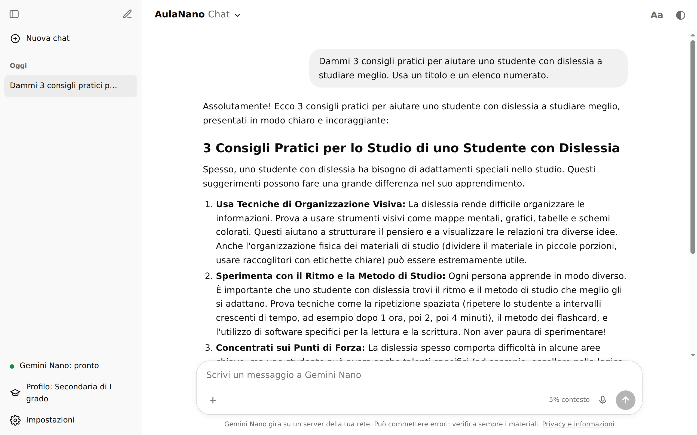
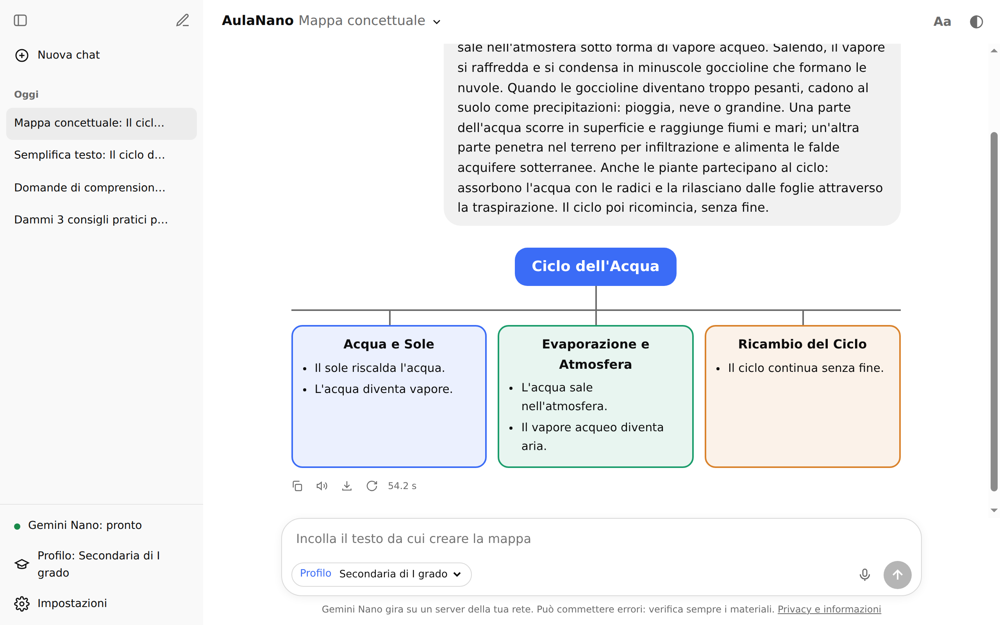
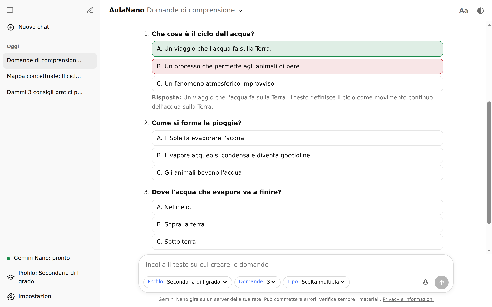
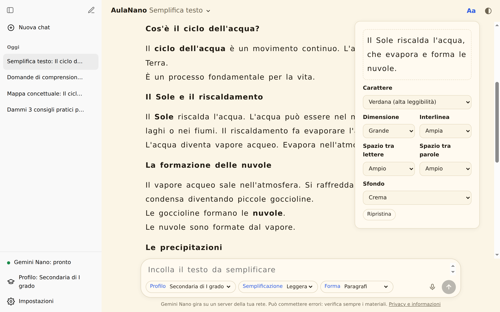
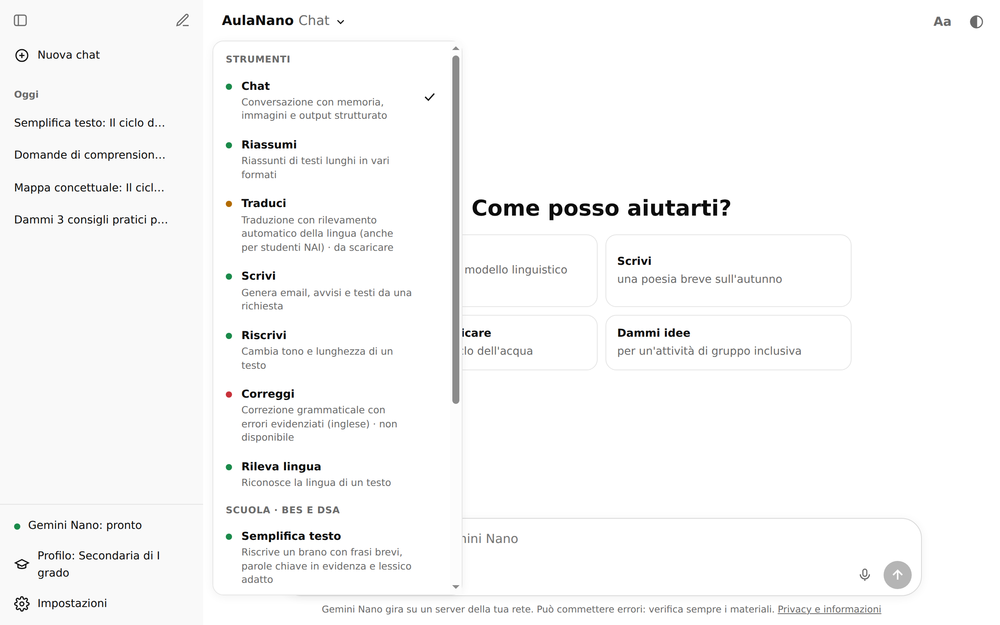
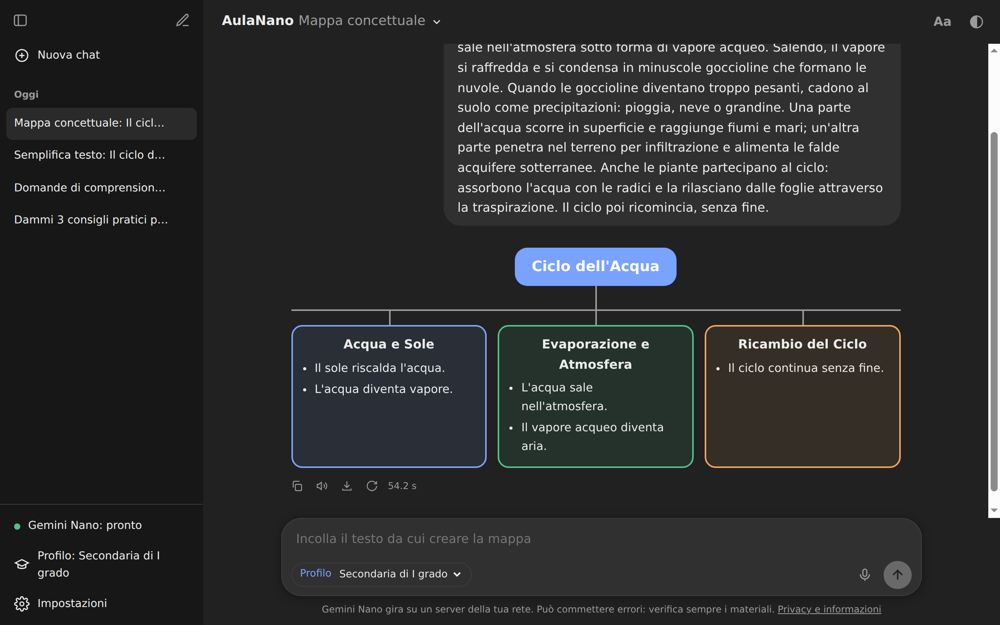

# AulaNano

**Assistente AI per docenti che lavorano con studenti con DSA e BES, che gira interamente in locale grazie a Gemini Nano integrato in Google Chrome.**

Nessun servizio cloud, nessuna chiave API, nessun costo: i testi restano sul computer della scuola (o su un server della propria rete). L'interfaccia è in italiano, in stile chat, e raccoglie in un unico posto tutte le funzioni del modello più strumenti pensati per la didattica inclusiva.

> Progetto indipendente e sperimentale, **non affiliato né approvato da Google**. "Gemini" e "Chrome" sono marchi di Google LLC.



## Funzionalità

### Strumenti per la scuola (BES e DSA)

| Strumento | Cosa fa |
|---|---|
| **Semplifica testo** | Riscrive un brano con frasi brevi, una informazione per frase, parole chiave in grassetto e termini tecnici spiegati. Semplificazione leggera o forte, a paragrafi o a elenco. |
| **Mappa concettuale** | Trasforma un testo in una mappa con concetto centrale, rami e dettagli. |
| **Glossario** | Trova le parole difficili e le spiega con una definizione semplice e un esempio concreto. |
| **Domande di comprensione** | Domande graduate a scelta multipla, vero/falso o aperte. Lo studente risponde direttamente nell'app e riceve una spiegazione. |
| **Scomponi la consegna** | Divide un compito in passaggi numerati, una sola azione per passaggio. |

Ogni strumento si adatta al **profilo dello studente** (primaria, secondaria di I o II grado).

| Mappa concettuale | Domande di comprensione |
|---|---|
|  |  |

### Accessibilità

- **Leggibilità**: caratteri ad alta leggibilità (Verdana, Arial, Century Gothic, OpenDyslexic o EasyReading se installati), dimensione, interlinea, spaziatura tra lettere e parole, sfondi crema/azzurro/verde/giallo.
- **Lettura vocale** con evidenziazione della frase e della parola letta, velocità regolabile e scelta della voce (voci di sistema, funziona offline).
- **Dettatura**: usa il riconoscimento vocale sul dispositivo quando disponibile; quella online va abilitata esplicitamente.
- **Esportazione** in Word o PDF con le impostazioni di leggibilità; per le domande, versione studente (senza soluzioni) e versione docente.

| Impostazioni di leggibilità | Tutti gli strumenti |
|---|---|
|  |  |

### Modelli open source da Hugging Face

Oltre a Gemini Nano, dalla finestra **Modelli** si possono scaricare con un clic modelli open source da [Hugging Face](https://huggingface.co), che girano **direttamente nel browser** grazie a [Transformers.js](https://huggingface.co/docs/transformers.js):

| Famiglia | Modelli nel catalogo |
|---|---|
| Google Gemma 3 | 270M, 1B |
| Meta Llama 3.2 | 1B, 3B |
| Alibaba Qwen | Qwen2.5 0.5B e 1.5B, Qwen3 0.6B, 1.7B e 4B |
| Hugging Face SmolLM2 | 360M, 1.7B |
| Microsoft Phi | Phi-3.5 mini |

- L'app sceglie da sola **dispositivo e quantizzazione**: WebGPU con `q4f16` se c'è una scheda video compatibile, altrimenti CPU (WebAssembly) con `q4`.
- I modelli restano nella **cache del browser** e funzionano anche offline; si possono eliminare in qualsiasi momento. Prima del download l'app controlla lo spazio disponibile.
- Su CPU i modelli usano più core solo se la pagina è *cross-origin isolated*: il bridge e l'app desktop inviano le intestazioni necessarie (`Cross-Origin-Opener-Policy` e `Cross-Origin-Embedder-Policy`), mentre il semplice `python3 -m http.server` della modalità locale no, quindi lì il modello usa un solo core.
- Una **ricerca nell'Hub** permette di aggiungere altri modelli: AulaNano verifica che abbiano file ONNX compatibili prima di proporli.
- Utili quando Gemini Nano non è disponibile (browser diverso da Chrome, hardware non idoneo). Con un modello Hugging Face funzionano la chat e tutte le funzioni Scuola; Riassumi, Traduci, Scrivi e Riscrivi diventano richieste al modello. Immagini e correzione restano esclusive di Gemini Nano.
- Ogni modello ha la propria licenza (Apache 2.0, MIT, Llama 3.2 Community License, Gemma Terms of Use), indicata nella scheda.

### Funzioni generali del modello

Chat con memoria della conversazione, immagini in input e output strutturato (JSON Schema); riassunti, traduzione con rilevamento automatico della lingua, scrittura e riscrittura, correzione grammaticale (inglese). Cronologia delle chat, tema chiaro e scuro, interfaccia responsive.



## Come funziona

Chrome (versione desktop recente) include le **API AI integrate** — Prompt API, Summarizer, Translator, Language Detector, Writer, Rewriter, Proofreader — che usano il modello **Gemini Nano** scaricato da Chrome sul dispositivo. AulaNano è un'interfaccia web che le usa direttamente, senza dipendenze esterne.

Sono previste tre modalità:

```
1. Locale          Chrome del PC ──► web/index.html ──► Gemini Nano (sul PC)

2. Server          Chrome del PC ──► tunnel SSH ──► server/bridge.mjs ──CDP──► Chrome headless ──► Gemini Nano
   (sperimentale)                                  (Node, sul server)        + server/worker.html  (sul server)

3. App desktop     AulaNano.exe ──► trova/installa Chrome, prepara un profilo dedicato ──► modalità 1
   (sperimentale)
```

La modalità server è utile quando il PC non ha i requisiti per Gemini Nano: un altro computer della rete esegue il modello e la stessa interfaccia lo usa da remoto. Uno *shim* JavaScript sostituisce le API del browser con proxy che inoltrano le chiamate al bridge, quindi l'interfaccia non cambia.

### Aspetti tecnici

- **Zero dipendenze installate**: solo HTML/CSS/JavaScript nel browser e Node.js standard lato server. Transformers.js viene caricato da CDN solo quando si sceglie un modello Hugging Face.
- **Adattatore Prompt API ↔ Transformers.js**: i modelli Hugging Face espongono la stessa interfaccia di `LanguageModel` (sessioni, streaming, interruzione, finestra di contesto, output JSON), quindi tutte le funzioni li usano senza modifiche.
- **Client CDP scritto da zero** (`server/cdp.mjs`): WebSocket minimale per comandare Chrome headless tramite Chrome DevTools Protocol.
- **Streaming** delle risposte via NDJSON dal bridge al browser, con interruzione delle generazioni.
- **Output strutturato** con `responseConstraint` (JSON Schema) per mappe, glossari e domande, con nuovo tentativo automatico quando il risultato è incompleto.
- Gestione della **finestra di contesto**: la memoria della chat viene ricostruita dalla cronologia scartando i messaggi più vecchi se necessario; i testi lunghi sono elaborati a blocchi.

## Avvio rapido

### Requisiti

Google Chrome desktop recente su Windows 10/11, macOS 13+ o Linux, con almeno **22 GB liberi** sul disco del profilo e una GPU con più di 4 GB di VRAM, oppure 16 GB di RAM e 4 core. Dettagli: [documentazione di Chrome](https://developer.chrome.com/docs/ai/get-started).

### 1. Modalità locale

```bash
python3 -m http.server 8000 --bind 127.0.0.1 --directory web
```

Apri `http://localhost:8000/` in Chrome. Se le API risultano non disponibili, attiva in `chrome://flags` i flag `optimization-guide-on-device-model` e `prompt-api-for-gemini-nano` (più quelli di Summarizer, Writer, Rewriter e Proofreader) e riavvia Chrome. Lo stato del modello si controlla in `chrome://on-device-internals`.

### 2. Modalità server (Linux)

Sul server (servono Node.js ≥ 18 e ~25 GB liberi):

```bash
cp server/.env.example server/.env   # imposta GN_BASE su un disco con spazio
server/setup-chrome.sh               # scarica Chrome da dl.google.com e lo estrae, senza root
server/start.sh                      # avvia il bridge su 127.0.0.1:8787
```

Dal PC client:

```bash
ssh -N -L 8787:127.0.0.1:8787 utente@server
```

Poi apri `http://localhost:8787/`. Il primo avvio scarica Gemini Nano (~4 GB). Il bridge ascolta solo su `127.0.0.1`: senza tunnel non è raggiungibile dalla rete.

Note: Chrome headless non usa la GPU, quindi il bridge forza la variante CPU del modello. Chrome estratto senza root gira con `--no-sandbox`. La modalità è pensata per uso personale e sperimentale.

### 3. App desktop per Windows (sperimentale, non ancora testata)

```bash
desktop/build-windows.sh   # richiede Node 22; crea desktop/build/AulaNano.exe
```

L'eseguibile si installa per l'utente corrente (menu Start, Desktop, voce in "App installate"), chiede il consenso prima di installare Chrome dal sito di Google, sceglie un disco con spazio sufficiente e apre l'interfaccia in una finestra dedicata. Non contiene né Chrome né il modello.

## Struttura

```
web/index.html        interfaccia (unico file)
web/studio.html       diagnostica delle API
server/bridge.mjs     bridge HTTP ↔ Chrome headless
server/cdp.mjs        client Chrome DevTools Protocol
server/worker.html    pagina eseguita dal Chrome headless
server/shim.js        proxy delle API nel browser client
server/*.sh           installazione e avvio
server/internals.mjs  stampa chrome://on-device-internals (diagnostica)
desktop/app.cjs       launcher desktop
docs/screenshots/     immagini del README
```

## Privacy, policy e limiti

- **Dati degli studenti**: non inserire nomi, diagnosi, contenuti del PDP o altri dati personali. Le informazioni su DSA e BES sono dati relativi alla salute, tutelati in modo rafforzato dal GDPR. Le chat sono salvate solo nel browser (`localStorage`).
- **Policy di Google**: l'uso delle API AI di Chrome è soggetto alla [Generative AI Prohibited Use Policy](https://policies.google.com/terms/generative-ai/use-policy) e ai [Termini di Google Chrome](https://www.google.com/chrome/terms). Questo repository non contiene né ridistribuisce Chrome o il modello: li scarica Google.
- **Affidabilità**: Gemini Nano è un modello piccolo e può sbagliare o inventare informazioni. I materiali vanno sempre verificati dal docente e il modello non deve essere usato per decisioni su valutazioni o percorsi degli studenti.
- **Lingue**: le lingue di output dichiarate ufficialmente per la Prompt API sono inglese, spagnolo, francese, tedesco e giapponese; l'italiano funziona ma senza garanzie.
- **Flag sperimentali**: alcune impostazioni (variante CPU, `BypassPerfRequirement`) non sono supportate ufficialmente da Google e possono smettere di funzionare con un aggiornamento di Chrome.
- **Prestazioni**: su CPU ogni materiale richiede 15–60 secondi; con una GPU adatta è molto più veloce.
- **Modelli Hugging Face**: i modelli sotto 1 miliardo di parametri sono rapidi ma spesso imprecisi, soprattutto in italiano e con le funzioni che producono JSON (mappe, glossari, domande); per un uso reale sono consigliati Qwen2.5 1.5B, Qwen3 1.7B o superiori. Il download avviene da huggingface.co.

## English summary

AulaNano is an Italian-language, ChatGPT-style web app that helps teachers create accessible learning materials for students with dyslexia and other special educational needs (simplified texts, concept maps, glossaries, comprehension quizzes, step-by-step instructions), with read-aloud, dictation, readability settings and Word/PDF export. Everything runs on-device through Chrome's built-in AI APIs (Gemini Nano). An optional zero-dependency Node.js bridge, with a hand-written Chrome DevTools Protocol client, runs the model in headless Chrome on a home server and proxies the APIs to other browsers over an SSH tunnel. Not affiliated with Google.

## Licenza

[MIT](LICENSE) © 2026 Alessio Baronti
